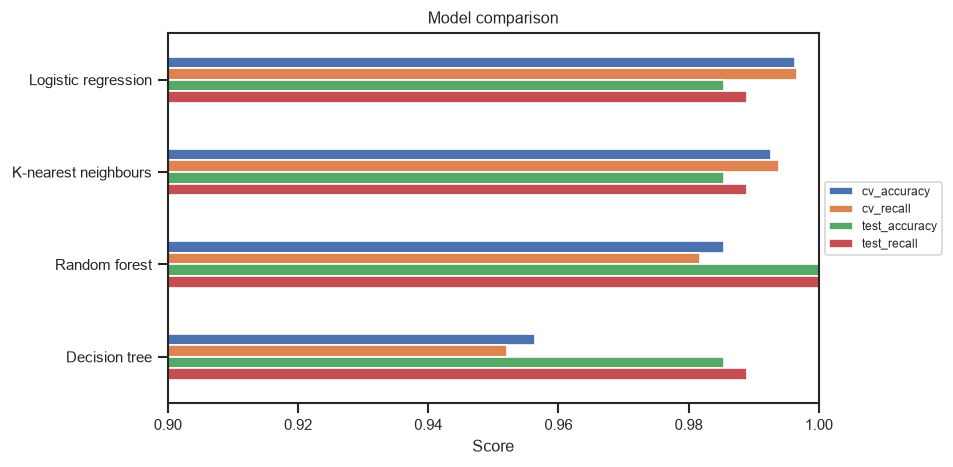
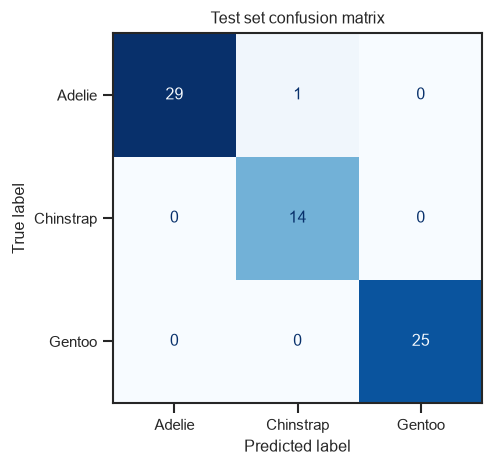
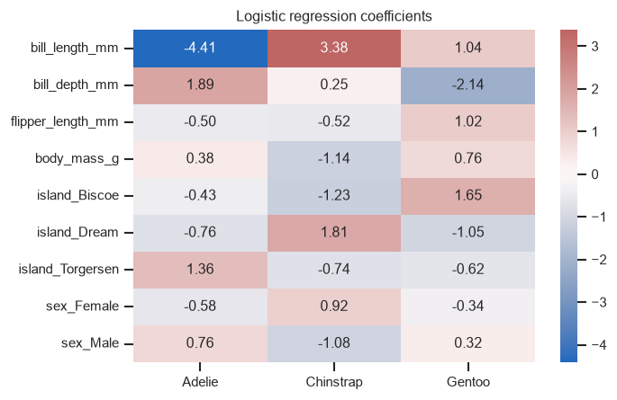

# 🐧 Which Penguin?

Classify Palmer penguins as **Adelie**, **Chinstrap** or **Gentoo** from their bill, flipper and body measurements, packaged as a single scikit-learn pipeline that takes raw, messy input and returns a prediction.


## Results

Four models were tuned with grid search and compared using 5-fold cross-validation (CV). Recall is macro-averaged, so each species counts equally.

| Model | CV accuracy | CV recall | Test accuracy | Test recall | Best settings |
|---|---|---|---|---|---|
| **Logistic regression** ✅ | **99.6%** | **99.7%** | 98.6% | 98.9% | `C=10`, L2 penalty |
| K-nearest neighbours | 99.3% | 99.4% | 98.6% | 98.9% | `k=1` |
| Random forest | 98.5% | 98.2% | 100% | 100% | 100 trees, no depth limit |
| Decision tree | 95.6% | 95.2% | 98.6% | 98.9% | `max_depth=4` |

**Logistic regression is selected** because it has the best CV accuracy. The random forest's perfect test score comes from a lucky split of only 69 penguins. Choosing a model by its test score would be cherry-picking, so the test set is used for reporting only. The top three models are within about one penguin per fold of each other, which makes the simplest and most interpretable model the sensible pick.

<p align="center">
  
</p>

The chosen model's one test-set error was an Adelie predicted as a Chinstrap, the two species that overlap most in the data.

<p align="center">
  
  
</p>

**What the model learned:** bill length is the strongest signal separating Adelie (short bills) from Chinstrap (long bills), while bill depth singles out Gentoo (shallow bills).

## Approach

1. **Explore** the dataset: class balance, missing values and how each measurement separates the species ([pairplot](reports/figures/pairplot.png)).
2. **Split** 80/20, stratified by species, with the test set held back until the end.
3. **Pipeline:** a `ColumnTransformer` imputes and scales numeric features and imputes and one-hot encodes `island`/`sex`, feeding a classifier. Because preprocessing is fitted inside the pipeline, cross-validation has no data leakage.
4. **Compare** logistic regression, k-nearest neighbours, a decision tree and a random forest. Each is tuned with `GridSearchCV` and scored on accuracy and macro recall.
5. **Select** the model with the best CV accuracy, evaluate it on the test set, interpret its coefficients and save the whole pipeline as one `joblib` file.

The saved model handles **missing values** and **unseen categories**; both are covered by tests.

The full walkthrough is in [`notebooks/which_penguin.ipynb`](notebooks/which_penguin.ipynb).

## Quickstart

Requires [uv](https://docs.astral.sh/uv/).

```bash
git clone https://github.com/<your-username>/which-penguin.git
cd which-penguin
uv sync
```

Train and save the model to `models/penguin_classifier.joblib`:

```bash
uv run train
```

Predict a single penguin (any measurement can be left out and will be imputed):

```bash
uv run predict --island Biscoe --sex Male --bill-length 48.6 --bill-depth 16.0 --flipper-length 230 --body-mass 5800
```

```
Predicted species: Gentoo
  Gentoo     100.0%
  Chinstrap    0.0%
  Adelie       0.0%
```

Run the tests:

```bash
uv run pytest
```

Open the notebook:

```bash
uv run jupyter lab notebooks/which_penguin.ipynb
```

> The dataset is downloaded by `seaborn` on first use, so the first run needs an internet connection.

## Project structure

```
which-penguin/
├── notebooks/
│   └── which_penguin.ipynb   # EDA → pipeline → model comparison → evaluation → interpretation
├── src/which_penguin/
│   ├── pipeline.py           # data loading, split, pipeline, models + grids, comparison
│   ├── train.py              # `uv run train`: compare models, save the best one
│   └── predict.py            # `uv run predict`: CLI inference
├── tests/
│   └── test_pipeline.py      # every model: accuracy, missing values, unseen categories
├── models/                   # trained model (git-ignored; created by `uv run train`)
├── reports/figures/          # charts used in this README
├── pyproject.toml
└── uv.lock
```

## Next steps

- Use repeated cross-validation to put confidence intervals on the scores, since the top models are within noise of each other.
- Serve the model behind a FastAPI endpoint with input validation.
- Add CI (GitHub Actions) to run the tests on every push.

## Data

[Palmer Penguins](https://allisonhorst.github.io/palmerpenguins/) by Allison Horst, Alison Hill and Kristen Gorman. Data collected by Dr. Kristen Gorman at Palmer Station, Antarctica LTER. Licensed CC0.

## License

[MIT](LICENSE)
